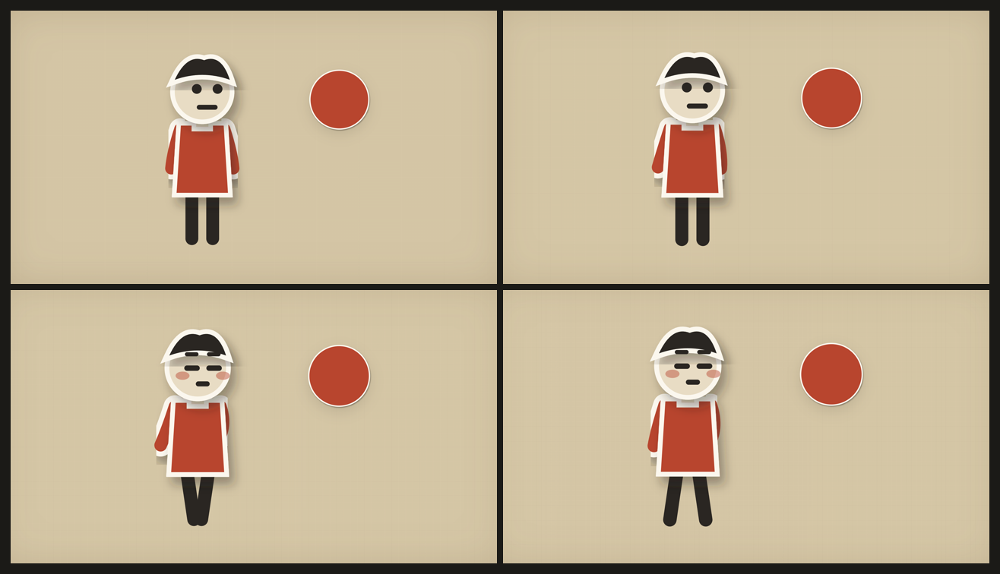

# mv-code — 一个歌名进去，一支代码 MV 出来

把 **「歌名」** 变成一支真正的 MV（mp4）。画面**全部由代码绘制**（Canvas 2D / p5.brush / DOM+CSS），经 [HyperFrames](https://hyperframes.heygen.com) 把 HTML 逐帧渲染成视频。

**零 AI 生图**：没有图像生成模型参与，所以造型前后一致、可无损重渲、不花一分钱生图费。

> 这是给 AI 编码 agent 用的 skill（技能包），不是 GUI 工具。装进支持 skills 的 agent（Claude Code / Codex / DeepSeek Harness 等），然后说一句话。

---

## 它长什么样

| | |
|---|---|
|  |  |
| 纸艺拼贴风单帧（1920×1080，模板实渲） | 关键帧总览 `storyboard.png`（第 6 步交付物） |

---

## 用起来就一句话

```
给《歌名》做支 MV
```

想带偏好就多说几个字：

```
给《歌名》做支 MV，像素风，竖屏
```

缺的东西 agent 自己填默认值，不会追着问。

---

## 它替你走完的八步

```
① 找音源 + 音乐分析   →  ② 三画风样图   →  ③ 角色模块   →  ④ 分镜
→ ⑤ 转场方案  →  ⑥ 关键帧总览  →  ⑦ 渲染成片  →  ⑧ 八项质检
```

| 步骤 | 产出 | 说明 |
|---|---|---|
| 0 环境 | 可跑的工程 | GSAP 本地内置、中文字体声明、模板一键复制 |
| 0.5 音源 | `assets/audio/song.mp3` (+`song.lrc`) | 没有文件时用 [musicdl](https://github.com/CharlesPikachu/musicdl) 按歌名搜——**它顺带给你官方歌词** |
| ① 分析 | `song.md`、`lyrics.srt` | 官方 LRC 转 SRT（首选）或 Whisper 兜底 + 乐评检索 + BPM/节拍/段落/重音 |
| ② 画风 | 三张同框样图 | 像素游戏 / 纸艺拼贴 / 蜡笔手绘，各出 1920×1080 一张 |
| ③ 角色 | `character.js` + 三视图 | 一次做对，全片复用：朝向 / 表情 / 动作 / 道具参数化 |
| ④ 分镜 | `storyboard.md` | 一句歌词一镜，切点吸附节拍，抽象句换成具体动作 |
| ⑤ 转场 | 回填分镜表 | 一镜到底 / 卡点切换 / 拼贴快切 三选一 + 衔接一致性表 |
| ⑥ 关键帧 | `storyboard.png` | 渲染前先看总览，省下几小时白烧 |
| ⑦ 成片 | `out/<歌名>.mp4` | 背景/角色/道具同一画布，字幕不随镜头，配原曲 |
| ⑧ 质检 | `QA.md` | 像幻灯片 / 运镜晃 / 表现力 / 道具 / 歌词演出 + 对齐 + 响度 + 静态检查 |

**四个停顿点**：选画风、确认角色、确认分镜、确认关键帧。用户点头前不渲染。

---

## 三种画风（都是代码画的）

### 像素游戏风
Canvas 2D，逻辑画布 320×180 整数倍放大 6 倍，`image-rendering: pixelated`。
全片 16~32 色，渐变用 Bayer 矩阵抖动点阵，角色逐帧换画不做补间。

### 纸艺拼贴绘本
DOM + 内联 SVG。每个元素带**剪纸白边**（`paint-order: stroke`）或撕纸毛边，双层投影，
旧报纸/牛皮纸底纹，画面每秒抖 8~12 次、每次 1~2 像素（定格动画感）。

### 蜡笔手绘绘本
p5.js 2.x + p5.brush，`WEBGL` 画布。同一根线重画 2~3 遍、每遍偏移 1~2px，
保留笔触毛边与纸张纹理。

---

## 安装

**没有 git 的话**：下载 zip 解压到下面的目录即可。

```bash
git clone https://github.com/cslkkl/mv-code.git ~/.agents/skills/mv-code
```

目录位置按你的 agent 而定：

| Agent | skills 目录 |
|---|---|
| 通用 / Claude Code | `~/.agents/skills/` |
| DeepSeek Harness | `~/.agents/skills/`（或 `~/.dsh/skills/`） |
| Codex | 见其 `SKILL.md` 发现规则 |

Windows 上是 `C:\Users\<你>\.agents\skills\mv-code\`。

装好后**重启会话**，agent 才会加载新 skill。

---

## 前置依赖

| 依赖 | 为什么要 | 检查 |
|---|---|---|
| **Node.js ≥ 22** | 跑 `hyperframes` CLI | `node -v` |
| **FFmpeg / FFprobe** | 渲染、抽帧、量响度 | `ffmpeg -version` |
| **Chrome / Chromium** | 逐帧截图渲染 | `npx hyperframes doctor` |
| Python 3.10+（可选） | 没有 SRT 时用 `faster-whisper` 转写；用 `musicdl` 找歌 | `python -V` |

一条命令自检：

```bash
npx hyperframes doctor
```

`whisper-cpp: Not found` 可以忽略（只影响自动转写）。

---

## 仓库结构

```
mv-code/
├── SKILL.md                       ← agent 读的入口
├── agents/openai.yaml             ← UI 卡片元数据
├── README.md
├── references/
│   ├── 00-setup.md                环境（GSAP 内置、中文字体、Python 取舍）
│   ├── musicdl.md                 音源获取
│   ├── 01-song.md                 音乐分析 → song.md
│   ├── 02-art.md                  三画风样图
│   ├── styles/
│   │   ├── pixel.md               像素风规格 + 抖动 + 逐帧
│   │   ├── paper.md               纸艺规格 + 剪纸白边 + 8~12fps 抖动
│   │   └── crayon.md              蜡笔规格 + p5.brush + instance mode
│   ├── 03-character.md            character.js 接口 + 三视图
│   ├── 04-storyboard.md           分镜格式 + 抽象→具体对照表
│   ├── 05-transition.md           三选一转场 + 衔接一致性表
│   ├── 06-keyframes.md            storyboard.png
│   ├── 07-build.md                同画布 + 相机 + 字幕 + 渲染
│   ├── 08-review.md               八项质检（含量化命令）
│   ├── hyperframes.md             契约 12 条 + 实测踩坑
│   └── playbook.md                一页流程卡
├── assets/scripts/
│   ├── lrc2srt.py                 官方 LRC → SRT（首选路线）
│   └── transcribe.py              Whisper 兜底（faster-whisper）
├── assets/templates/              ← 复制即用的骨架
│   ├── index.html                 根 composition（场景 + 字幕层 + 音轨）
│   ├── scene.html                 单场骨架（相机 + 分层 + 角色）
│   ├── character.js               角色模块（pose / pixel / paper / crayon）
│   ├── srt.js                     SRT 解析 + 收紧 + 逐帧取句
│   ├── hyperframes.json
│   ├── package.json
│   ├── song.md / storyboard.md / style-choice.md / QA.md
└── docs/
    ├── frame-paper.png
    ├── storyboard-demo.png
    └── verification.md            实测记录（做了什么、跑通到什么程度）
```

---

## 已验证

在本机实测（hyperframes 0.8.214 / Node 24 / Chrome headless / Ryzen 9 7940H）：

- **musicdl 装通并真实下载成功**（57 个平台客户端；歌名 → FLAC + 官方 LRC）
- **LRC → SRT**：5:32 的歌 → 79 行 LRC → 72 条 SRT，时间单调无重叠
- **Whisper 兜底跑通**（faster-whisper 1.2.1）；small/medium 准确率实测，中文必须 medium
- 模板复制 → `check` **ok: true**，lint / runtime / layout / motion / contrast 全绿
- 模板 → `render -q draft` → 6 秒 1920×1080 H.264 + AAC 成片
- 三种画风都出过可看的帧
- `hyperframes audio` 测 120 BPM 样本 → 120.0 / confidence 0.991 / 119 个节拍点
- 静止段检测：静态画面 YAVG 0.0000 vs 正常画面 3~13
- 响度比对：源 -34.1 / 成片 -31.1 LUFS，差 3.0 判超标；重封装后回到 -34.1

细节与未跑通的部分见 [docs/verification.md](docs/verification.md)。

---

## 成本预期（先跟人讲清楚）

| 阶段 | 时长 | 花费 |
|---|---|---|
| 找歌 + 分析 | 15~30 分钟 | 0 |
| 三张样图 | 20~40 分钟 | 0 |
| 角色 + 设定图 | 20~40 分钟 | 0 |
| 分镜 + 转场 | 40~80 分钟 | 0 |
| 关键帧总览 | 30~60 分钟 | 0 |
| 全片实现 | 2~5 小时 | 0 |
| 渲染 | 10 分钟~1 小时 | 电费 |
| 质检 + 返工 | 30~90 分钟 | 0 |

**全流程 4~8 小时（3 分钟的曲子），零生图费用。** 这不是「40 分钟出片」的东西：
它用时间换一致性 —— 造型不漂、可无损重渲、改一版不用重新烧钱。

---

## 和 AI 生图路线怎么选

| | 本仓库（代码绘制） | AI 生图路线 |
|---|---|---|
| 出片速度 | 4~8 小时 | 30~60 分钟 |
| 单支成本 | 0 | 几十~几百元 |
| 角色一致性 | 强（一个 `character.js`） | 弱（每张重画） |
| 反复重渲 | 免费 | 每次都要重生图 |
| 写实程度 | 低（手绘/像素/纸艺） | 高 |

要「像实拍」走 AI 生图；要「风格统一、能改、不花钱」走这套。

---

## License

代码与文档 MIT。注意两条第三方约定：
- **HyperFrames** 是 Apache-2.0（独立安装，本仓库不打包）。
- **musicdl** 是 PolyForm Noncommercial —— 个人做 MV 没问题，商用要自行处理。
- 歌曲版权归权利人，本仓库不提供任何音源。
